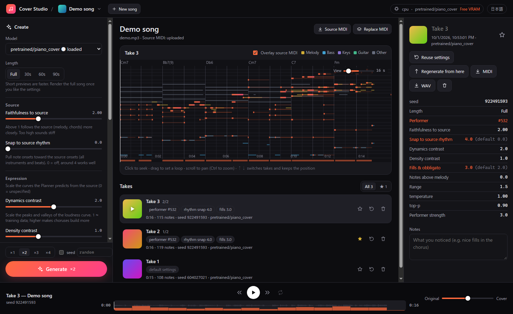
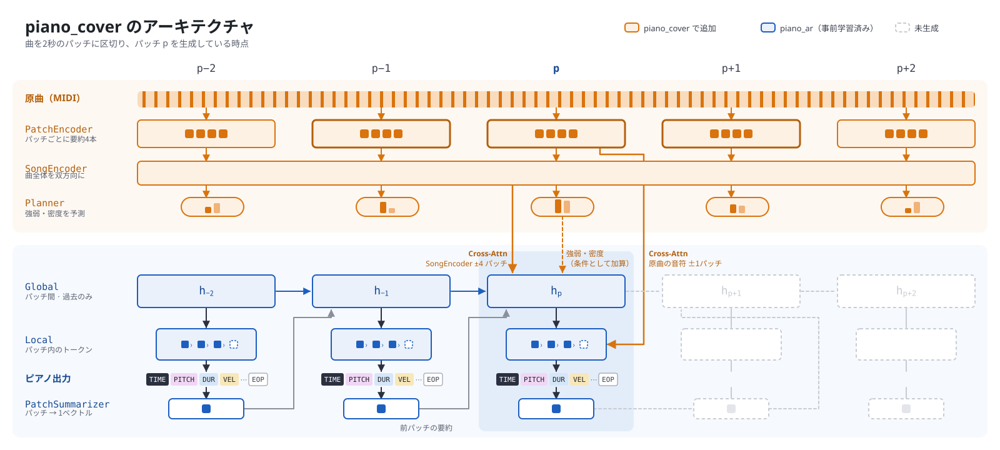
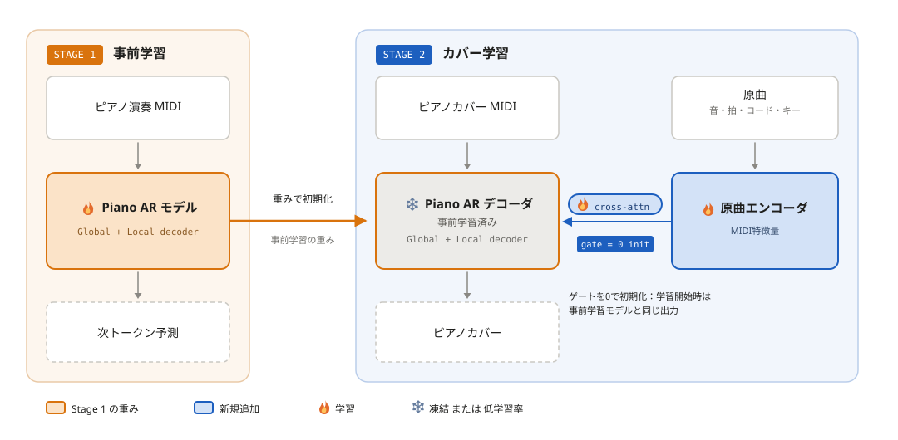

# tsumugi-piano-cover

**ポピュラー楽曲の音源からピアノカバーMIDIを生成するリポジトリです。** 原曲音源を [tsumugi](https://github.com/anime-song/tsumugi) で複数楽器のMIDIに自動採譜し、約3,000時間のピアノ演奏データで事前学習した自己回帰モデルによってピアノアレンジを生成します。

[English README](README.md) | [](LICENSE) | [](https://huggingface.co/anime-song/tsumugi-piano-cover-v2) | [](https://colab.research.google.com/github/anime-song/tsumugi-piano-cover/blob/main/notebooks/cover_studio_colab_ja.ipynb)

- 🎹 **原曲と完全同期**: 原曲音源のタイムラインに合わせてカバーが生成され、重ねて同時再生可能
- 🎚️ **柔軟な編曲コントロール**: 原曲再現度、強弱ダイナミクス、オブリガート（合いの手）、音域、演奏者スタイルを指定可能
- 🔁 **Cover Studio**: パラメータ調整、テイク比較、任意位置からの部分再生成（インペインティング）に対応したWeb UI

## 📢 更新情報

- **2026-10-21 — カバーを楽譜にできるようになりました**（[anime-song/tsumugi-piano-cover-v2](https://huggingface.co/anime-song/tsumugi-piano-cover-v2) の `piano_perf2score/`）
  - V2 で作ったカバーを、ピアノの大譜表の楽譜（MusicXML）にできます。小節線は原曲の拍に合わせ、コード記号とテンポも書きます。
  - Cover Studio ではテイクを開いて「楽譜にする」を押します。楽譜はブラウザ内（[Verovio](https://www.verovio.org/)）で描くので楽譜ソフトは要りません。MusicXML のダウンロードと、印刷・PDF 保存ができます。
- **2026-10-20 — V2 を公開しました**（[anime-song/tsumugi-piano-cover-v2](https://huggingface.co/anime-song/tsumugi-piano-cover-v2)）
  - **リズムの崩れが減りました**: [SheetSage2-Refined](https://huggingface.co/anime-song/SheetSage2-Refined) で推定した拍の上で、小節ごとに生成するようにしました。
  - **原曲の再現度が上がりました**: SheetSage2-Refined のメロディと原曲音源の特徴もモデルに渡すことで、メロディがよく再現されるようになりました。
  - Cover Studio と Colab ノートブックは V2 が既定です。V1 も引き続き選択でき、MIDI ファイルだけでも生成できます（V2 は原曲の音源が必要です）。
  - 以下の Python API・アーキテクチャ・学習の説明は V1 のものです。V2 の使い方と詳細は [V2 のモデルカード](https://huggingface.co/anime-song/tsumugi-piano-cover-v2) を参照してください。

---

## クイックスタート

### Google Colab

最も手軽な実行方法は Colab ノートブック（[日本語](https://colab.research.google.com/github/anime-song/tsumugi-piano-cover/blob/main/notebooks/cover_studio_colab_ja.ipynb) / [English](https://colab.research.google.com/github/anime-song/tsumugi-piano-cover/blob/main/notebooks/cover_studio_colab_en.ipynb)）です。GPU ランタイムを選択して最初のセルを実行し、「▶ Cover Studio を開く」をクリックすると、ブラウザ上で音源のアップロード、採譜、生成、テイク比較、ダウンロードまで完結します。

### ローカル環境

Python 3.12 と NVIDIA GPU（CUDA環境）を推奨します（CPUでも動作しますが生成に時間を要します）。

```bash
git clone https://github.com/anime-song/tsumugi-piano-cover.git
cd tsumugi-piano-cover
python -m venv .venv
.venv/bin/pip install -r requirements.txt     # Windows: .venv\Scripts\pip
.venv/bin/python -m cover_studio              # http://127.0.0.1:8100 が起動
```

モデルの重みは初回生成時に Hugging Face から自動ダウンロードされます。Web UI もビルド済み静的アセットを GitHub Releases から自動取得するため、Node.js のインストールは不要です。

Cover Studio 内で音源から直接採譜を行う場合は、`.tsumugi/tsumugi` に tsumugi をセットアップしてください。

```bash
git clone https://github.com/anime-song/tsumugi.git .tsumugi/tsumugi
cd .tsumugi/tsumugi
uv sync --locked --extra stem
```

Cover Studio は上記パスを自動検出し、tsumugi 環境の Python で採譜タスクを実行します（別のパスに配置する場合は `--tsumugi-dir` で指定）。Windows 環境では torchcodec の依存関係として FFmpeg 共有ライブラリが必要です。`.tsumugi/ffmpeg-shared/bin` に配置するか `--ffmpeg-dir` を指定してください。なお、事前に採譜済みの MIDI ファイルがある場合は、tsumugi を導入しなくても音源と一緒にアップロードすることでそのまま生成可能です。

---

## Cover Studio



音源の採譜は曲ごとに初回のみ実行されます。モデルはメモリに常駐するため、パラメータを変更しながら高速に再生成を試すことができます。

- **テイク履歴管理**: 生成ごとの設定パラメータ、乱数シード、モデル情報を保存。「設定を使う」でパラメータを即座に復元。デフォルト値から変更された項目はチップ表示
- **任意位置からの再生成**: 再生ヘッド位置より前を維持し、指定位置以降のみ新しい設定で再生成
- **同期再生とテイク比較**: 原曲音源とカバーを同一タイムライン上で同期再生。テイク切り替え時（↑ / ↓）も再生位置を保持。原曲 MIDI をオーバーレイ表示するピアノロール、ループ再生、原曲/カバーの音量バランス調整に対応
- **リアルタイム採譜表示**: tsumugi がパート（ステム）ごとに採譜したノートをピアノロール上へ順次描画
- **エクスポート**: 標準 MIDI 出力、ブラウザ内サンプリング音源による WAV レンダリング
- **楽譜**: テイクをピアノの楽譜にする（音源のある V2 のプロジェクト）。ブラウザで表示し、MusicXML のダウンロードと印刷・PDF 保存ができます
- **各種機能**: お気に入り登録、メモ機能、演奏者プリセット、日本語/英語 UI 切り替え

```bash
python -m cover_studio --root D:/covers --port 8080 --no-browser
python -m cover_studio --device cpu
```

---

## Python API / CLI

```python
from piano_cover.generate import CoverParams, generate_covers, prepare_source
from piano_cover.model import CoverModel

model = CoverModel.from_pretrained(device="cuda")  # anime-song/tsumugi-piano-cover
source = prepare_source("song.mid", model.tokenizer, model.config)  # tsumugi で採譜したマルチトラック MIDI
cover = generate_covers(model, source, CoverParams(seconds=60, fill=2.5))[0]
model.tokenizer.events_to_midi(cover.events, "cover.mid")
```

```bash
python -m piano_cover.generate --checkpoint anime-song/tsumugi-piano-cover --source song.mid --seconds 60
python -m piano_ar.generate --checkpoint anime-song/tsumugi-piano-cover --seconds 60   # 原曲条件なしのソロピアノ生成
```

入力する原曲 MIDI は、モデル学習時と同じ条件（ステム分離・楽器分類リファイン・ベロシティ推定・ビート/コード/キー推定を有効化）で tsumugi 採譜されたものである必要があります。[`cover_studio/tsumugi_worker.py`](cover_studio/tsumugi_worker.py) がこのパイプラインを実行します。

### 主な生成パラメータ

| パラメータ | 既定値 | 説明 |
| --- | --- | --- |
| `source_cfg` | 2.0 | 原曲 MIDI に対するガイダンス強度（CFG）。高いほど主旋律やコード進行を厳密に追従 |
| `onset_bias` | 0.0 | ノートの発音タイミングを原曲の発音に引き寄せる強度（推奨値: 約4.0） |
| `dynamics` / `density` | 2.0 / 1.0 | 原曲から予測されたベロシティおよび発音密度の軌道スケーリング係数 |
| `fill` / `above` / `span` | 2.0 / 0.0 / 1.5 | オブリガート頻度、メロディ上声部の付加量、使用音域（標準偏差単位でのオフセット） |
| `channel` / `channel_cfg` | 0 / 3.0 | 演奏者スタイルインデックス（0 = 指定なし）およびその追従強度 |
| `temperature` / `top_p` | 1.0 / 0.90 | サンプリングパラメータ |
| `seconds` | 全長 | 生成する長さの秒数（冒頭のプレビュー生成向け） |

---

## アーキテクチャと仕組み



- **2段階生成**: 楽曲を **2秒ごとのパッチ** に分割して処理します。大域的な展開を担う Global Transformer と、パッチ内の個別ノートイベント（時刻・音高・発音長・ベロシティ・ペダル）を10 ms精度で生成する Local Transformer の2段構成です。
- **原曲コンディショニング**: 原曲は **tsumugi のマルチトラック MIDI**（ドラムを含む全楽器ノート、拍・コード・調情報）として入力され、パッチごとに集約・曲全体にわたってエンコードされます。
- **Gated Cross-Attention**: デコーダはゲート付き Cross-Attention（初期値0）を介して原曲情報を参照します。Global は現在位置周辺の楽曲コンテキストを、Local は原曲の個別ノートを直接参照します。
- **Arrangement Planner**: 原曲から強弱・密度・編曲特性の軌道を予測し、生成時の条件信号として供給します。各種パラメータはこの軌道をスケールします。
- **非伸縮アライメント学習**: 学習時にカバー側MIDIを原曲の時間軸へ **タイムストレッチ（伸縮）しません**。対応関係は Cross-Attention の参照窓の位置決定にのみ用いるため、アライメント誤差によるリズムの歪みが生じません。



1. **事前学習（`piano_ar`）**: 約3,000時間のソロピアノMIDIデータ（自動採譜音源、PiJAMA、Pop2Pianoピアノパート、PIAST、MAESTRO等）。
2. **ファインチューニング（`piano_cover`）**: 約780曲・約3,000テイク（約190時間）のピアノカバー演奏と、原曲を tsumugi で採譜したペアデータ。

※ 学習データセットの再配布は行っていません。

---

## ディレクトリ構成

| パス | 内容 |
| --- | --- |
| [`piano_ar/`](piano_ar) | 単体ピアノ演奏生成モデル（トークナイザー、アーキテクチャ、事前学習コード） |
| [`piano_cover/`](piano_cover) | カバー生成モデル（原曲エンコーダ、Planner、データセット前処理、学習、推論） |
| [`cover_studio/`](cover_studio) | Cover Studio バックエンドサーバー（FastAPI）および tsumugi 連携ワーカー |
| [`web/`](web) | Cover Studio フロントエンド（React + Vite）。`npm run dev` / `npm run build` |
| [`notebooks/`](notebooks) | Google Colab ノートブック |
| [`piano_score/`](piano_score) | 楽譜のトークン化・MusicXML の読み書き・楽譜の言語モデル |
| [`piano_perf2score/`](piano_perf2score) | 演奏から楽譜を起こすモデル（カバーを MusicXML にする） |

学習済みチェックポイントを公開フォーマットへエクスポートするコマンド: `python -m piano_cover.export --checkpoint <best.pt> --out <dir>`（事前学習ピアノモデルは `piano_ar.export`）。

---

## 制限事項・既知の課題

- tsumugi による採譜の誤り（主旋律の取り違え、ビート推定やコード認識のズレ）は生成されるカバーにそのまま反映されます。特にリズム生成は入力 MIDI の拍グリッドに強く依存します。
- シャッフルやスウィングのリズムがイーブン（均等割り）に平準化される傾向があります。
- 人間の生演奏と比較して、サステインペダルを踏み続ける時間が長くなる傾向があります。
- カバーモデルの出力はニュアンスを含む演奏表現としての MIDI です。楽譜化のモデルは弾いた音をそのまま書くので、カバーの重ねた音や広い和音は楽譜にも残ります。

## ライセンス

- ソースコード: [MIT License](LICENSE)
- モデル重み（[V2](https://huggingface.co/anime-song/tsumugi-piano-cover-v2) / [V1](https://huggingface.co/anime-song/tsumugi-piano-cover)）: [CC BY-NC 4.0](https://creativecommons.org/licenses/by-nc/4.0/deed.ja)（非商用利用のみ）。V2 が拍とメロディの推定に使う [SheetSage2-Refined](https://huggingface.co/anime-song/SheetSage2-Refined) も非商用です

## 謝辞

- [tsumugi](https://github.com/anime-song/tsumugi) — 原曲音源のマルチトラック自動採譜
- [SheetSage2-Refined](https://huggingface.co/anime-song/SheetSage2-Refined) — 拍とメロディの推定（V2）
- [smplr](https://github.com/danigb/smplr) — Cover Studio のブラウザ内ピアノ再生音源
- [Verovio](https://www.verovio.org/) — Cover Studio のブラウザ内の楽譜表示
- [PERiScoPe](https://huggingface.co/datasets/SyMuPe/PERiScoPe) — 演奏と楽譜の対応データ（楽譜化のモデルの学習）
- [audio2chordpro](https://github.com/anime-song/audio2chordpro) — Cover Studio の設計ベース
